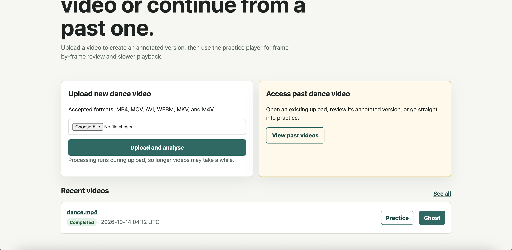
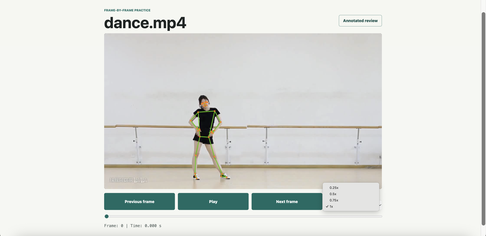
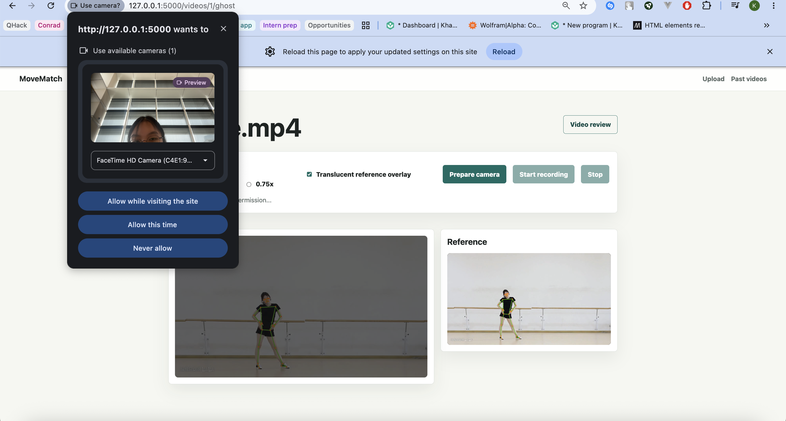
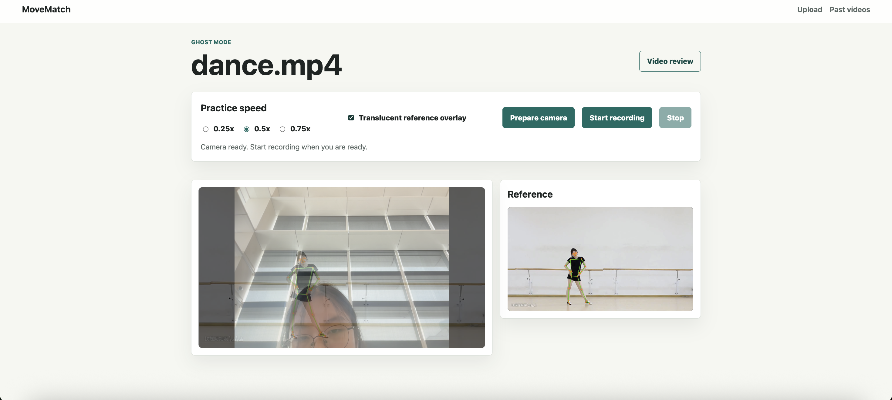
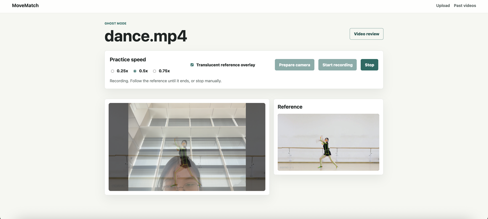
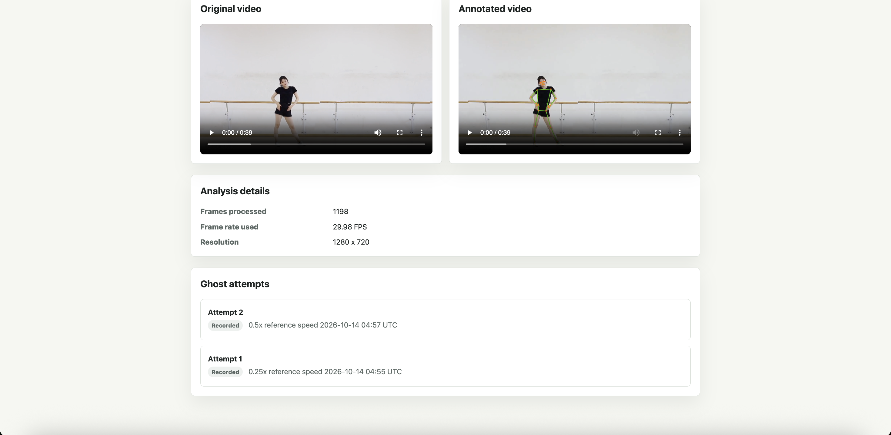

# MoveMatch
## Purpose
Targeted at recreational dancers who need more individualized and structured practices in preparing for a performance.

## Personal motivation 
Throughout my performance preparation journey at NUS High, cleaning movements and synchronizing dancers have always been the most time-consuming (more than 100 hours for a 4.5-minute performance!!) due to the mismatch between how the instructors' (my co-leaders and I) view certain moves and give corresponding instructions and the dancers' anatomy or even their differing interpretations of certain instructions.

MoveMatch intends to give objective numerical evaluations that standardize each dancer to the same reference dance video, allowing each individual to have their tailored practice. Ultimately, the project hopes to reduce the instructors' workload to bringing the group performance together, increasing the effectiveness group practices.

## Demo
The user can:
* Choose a short dance reference.
* Practice a specific section.
* Record an attempt.
* Watch their attempt alongside the reference.
* Receive understandable feedback.
* Retry and compare results.
Video pending!

## Screenshots







## Contributions
* Pose-tracking: Done with MediaPipe Pose Landmarker Lite model. 
* Evaluations: Metrics for evaluation were defined by the developer. The implementation and testing was done with Claude under supervision and quality check of the developer.
* Web framework: Flask routing and backend handling + Jinja2 templating with HTML, CSS, Js
* Database: Done on SQLite, integrated with Flask using Flask-SQLAlchemy
* Display: Video rendering and annotating was done with OpenCV

## Technical decisions
* Due to limited computational resources, the functionality is limited to single-dancer use

<<<<<<< Updated upstream
# Future work
I initially came across HybrIK: Hybrid analytical-neural inverse kinematics for body mesh recovery, but I couldn't install the repo for local testing on Mac. 3D body mesh promises even more precise sample(cannot install all required setup on Mac)
=======
## The journey

1. **Choose a short reference** (≤ 90 s; one dancer, full body, front view). Processing runs in the background
   with a progress bar. The music is kept.
2. **Practise a section**: loop it, slow it to 0.25–0.75× (pitch preserved), step frame by frame, toggle the
   skeleton overlay and mirror view.
3. **Record an attempt**: a full-body positioning guide, a 3/5/10-second countdown with beeps, and the
   reference skeleton as a ghost over your camera at any speed, including normal speed.
4. **Replay side by side** (or as a ghost overlay): the reference follows the exact moment it was showing
   while you recorded, including slow speed and buffering pauses.
5. **Read feedback**: your timing offset, the key moments worth reviewing (with "Show in replay"), and the
   joint-angle differences behind each note. If tracking was poor you get the reason ("your legs were below
   the bottom edge of the frame"), not a low score.
6. **Retry and compare**: every attempt at the same section is judged at the same moments, so you can see
   which moments improved.

Each attempt also gets a **provisional score out of 100** for tracking your progress on a section:
posture at key moments 70%, timing 20%, completion 10%, always shown with that breakdown. There is no
score when feedback is withheld, so a camera problem never turns into a low mark. The score has not yet
been checked against a teacher's judgment (see [`docs/evaluation.md`](docs/evaluation.md)), so the notes
explain more than the number.

## Quick start

Requires Python 3.11 and FFmpeg (`brew install ffmpeg`). Full guide, including troubleshooting:
[`docs/setup.md`](docs/setup.md).

```bash
python3.11 -m venv .venv && source .venv/bin/activate
pip install -r requirements-dev.txt
python scripts/download_model.py
cp .env.example .env
flask db upgrade
flask run
```

Open <http://localhost:5000>. There is no sample dance footage in the repository (no clip with clear
redistribution rights). Record a 10–20 s clip of yourself, or see `flask add-sample` in the setup guide.

```bash
pytest
```

231 automated tests, including one complete journey on a generated fixture video.

## How it works

| Step | What happens | Code |
|---|---|---|
| Pose detection | Google's pretrained **MediaPipe Pose Landmarker** finds 33 body landmarks per frame. MoveMatch does not train a model. | `process_video.py` |
| Constant frame rate | Every video is transcoded once to a constant frame rate (keeping the audio), so landmark timestamps equal the browser's playback time. | `media.py` |
| Synchronization | While recording, the browser logs which reference frame was on screen at each moment. The server maps every recorded frame to that reference time; stalls and pauses are excluded. | `sync_timeline.py`, `static/js/ghost_mode.js` |
| Normalization | Hip-centred, scaled by a smoothed torso length; orientation kept (turns are choreography). Joint angles do not depend on body size or camera distance. | `pose_utils.py`, `pose_pipeline.py` |
| Feedback | Tracking check → timing offset → joint angles at reference key moments, with timing removed; a flag needs the 3-D and 2-D views to agree. | `feedback.py` |
| Background jobs | Uploads return immediately; processing reports progress and can be retried. | `jobs.py` |

The reasoning, including what was tried and changed, is in
[`docs/technical_decisions.md`](docs/technical_decisions.md): normalization, synchronization, missing
landmarks, mirror mode, and the limitations of one camera.

## Status

**Working**
* The full journey above, on a laptop with a webcam (Chrome, Edge, Firefox or Safari).
* Feedback: timing offset with drift detection, key-moment joint angles, missed-turn detection, partial or
  withheld feedback when parts of the body are not visible.
* Reliability: background processing with progress, content-based upload validation with duration,
  resolution and size limits, retryable uploads that never duplicate, cleanup of failed and intermediate
  files, Alembic-only migrations.
* Privacy: delete controls, a privacy page, and an optional public-demo mode (anonymous ownership, CSRF
  protection, rate limits, 24-hour retention, strict security headers, required production secret).

**Limitations**
* Tested so far on synthetic cases with known answers (20 of 21 behave as expected) and on a handful of real
  recordings, **not yet against a dance teacher's judgment** ([`docs/evaluation.md`](docs/evaluation.md)).
* One camera: depth is guessed, so reaching forward vs. sideways is invisible to joint angles; back-facing
  parts can swap left and right; symmetric moves hide mirror mistakes.
* One dancer, a fixed camera, the whole body visible, short sections.
* Thresholds (20°/35°, ±0.15 s) are provisional.

**Planned**
* Teacher comparison study and user testing with dancers from my group ([`docs/user_testing.md`](docs/user_testing.md)).
* A live "you're out of frame" warning during recording (in-browser pose detection).
* Beat-aware timing (offsets in beats instead of seconds).

## Evidence of iteration

* **Prototype** ([`assets/prototype/`](assets/prototype/)): uploads processed inside the request, a silent
  annotated video, two unsynchronized video players for ghost mode, attempts saved but never evaluated.
* **Problems found and fixed:** music dropped by the conversion; ghost drift after buffering; the recording
  could keep running after a playback error; double clicks started overlapping recordings; failed uploads were
  lost; variable-frame-rate timing; a migration chain that only worked on an existing database.
* **Changes driven by the evaluation set:** false "bent knee" flags from depth error led to the 3-D/2-D
  agreement rule; moments after an early stop are no longer judged; per-side tracking regions. Details in
  [`docs/evaluation.md`](docs/evaluation.md).
* **Feedback from other users:** none recorded yet; the plan is in [`docs/user_testing.md`](docs/user_testing.md).

## Repository layout

```
app.py, config.py, models.py, security.py   Flask app, settings, database models, ownership/CSRF/limits
jobs.py, media.py, process_video.py         background processing, FFmpeg, MediaPipe extraction
sync_timeline.py, feedback.py               synchronization and the feedback method
pose_utils.py, pose_pipeline.py             normalization, angles, mirror convention
landmark_store.py                           versioned landmark cache (.npz) with stale-cache detection
templates/, static/                         pages and browser code (no build step)
migrations/                                 Alembic schema history
evaluation/                                 synthetic evaluation set and teacher-comparison tooling
research/                                   DTW alignment and score-calibration experiments (not used for feedback)
scripts/                                    model download; scripts/demos/ = manual MediaPipe demos (not tests)
tests/                                      automated pytest suite
docs/                                       setup, technical decisions, evaluation, user testing, developer notes
```

## License and credits

Code: MIT ([`LICENSE`](LICENSE)). Third-party models and libraries: [`CREDITS.md`](CREDITS.md).
>>>>>>> Stashed changes
